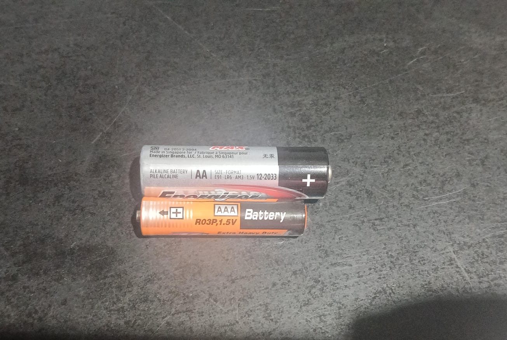

NOTA: A medida que se realizan las bitácoras deberán ser subidas al repo correspondiente

# BITÁCORA DE PROYECTO – ROBOT SUMO

## Equipo: Número 2 (4to 2da AVC Com A)
## Nombre del Robot:B-567
## Capitán: Blasi Maximo
## Subcapitán: Barrientos Dylan
## Integrantes:
- Baruque Mercedes
- Borecki Florencia
- Borecki Nicolas

## REGISTRO DE ACTIVIDADES
### Fecha: 26/10/2026
### Integrantes presentes:
- Barrientos, Dylan.
- Baruque, Mercedes.
- Blasi, Máximo.
- Borecki, Florencia.
- Borecki, Nicolás. 

### Objetivos de la jornada:
- Finalizar la carcasa del chasis.
- Soldar ciertos componentes.
- Poner a prueba los motores.
- Subir el código ya finalizado.

### Actividades realizadas:
- Se soldaron los componentes necesarios para la fecha.
- Se logró finalizar el chasis.
- Se subió el código necesario.
- Se comenzó a probar el circuito físico, pero no se lo logró terminar.

### Problemas encontrados:
- Falta de estaño.
- Confusión el los pines durante el armado.
blob:https://web.whatsapp.com/3ade5102-71c2-48fe-8f01-b29972ce301d

### Fotografías, diagramas o evidencias: (Adjuntar imágenes, capturas de pantalla o esquemas)
!(blob:https://web.whatsapp.com/7740eea3-c668-4646-96eb-8417aa12734a)
!(blob:https://web.whatsapp.com/b52c41eb-f111-4897-9ff9-1f1fe9f440c0)
!(blob:https://web.whatsapp.com/b8b47dab-bfb8-41c4-99b0-14ef77472e76)
!(blob:https://web.whatsapp.com/3ade5102-71c2-48fe-8f01-b29972ce301d)

### Tareas pendientes:
- Impresión de la carcasa.
- Probar el funcionamiento de los motores. 
- Finalizar el armado completo del circuito.
- 

### APORTES INDIVIDUALES
Integrante: Blasi, Máximo

Tarea realizada: Contribuí cuando soladaron, así como guarde el programa.

Integrante: Barrientos, Dylan

Tarea realizada: Me encargué de finalizar el diseño de la carcasa del chasis.

Integrante: Baruque, Mercedes

Tarea realizada: Me encargué de soldar los componentes, y ayudé a Maximo Blasi a guardar el programa

Integrante: Borecki, Florencia
Tarea realizada: Ayude a soldar y terminé de revisar el circuito electrónico

Integrante: Borecki, Nicolás

Tarea realizada: Realicé el circuito en la protoboard (que no se llegó a terminar) y contribuí con la carcasa del chasis. 
